<p align="center">
  
</p>

<h1 align="center">Tesserae Companion</h1>

<p align="center">
  The official native iOS companion for <a href="https://github.com/dmellok/tesserae">Tesserae</a>.<br>
  Control displays, send content, and run everyday actions from your iPhone or iPad.
</p>

<p align="center">
  <a href="https://testflight.apple.com/join/gjQar3TK"></a>
  
  
  <a href="LICENSE"></a>
</p>

<p align="center">
  <strong><a href="https://testflight.apple.com/join/gjQar3TK">Join the TestFlight beta</a></strong>
  &nbsp;&middot;&nbsp;
  <a href="https://github.com/dmellok/tesserae">View Tesserae</a>
  &nbsp;&middot;&nbsp;
  <a href="PRIVACY.md">Privacy</a>
</p>

## Your displays, from your iPhone or iPad

Check what is showing, adjust a Dashboard, send a photo, or manage a Lineup.
Tesserae Companion connects directly to your own Tesserae server, with a built-in
**Demo Mode** for exploring the app before pairing.

<table>
  <tr>
    <td align="center"><a href="docs/images/readme/displays-visible-logo-spacing.png">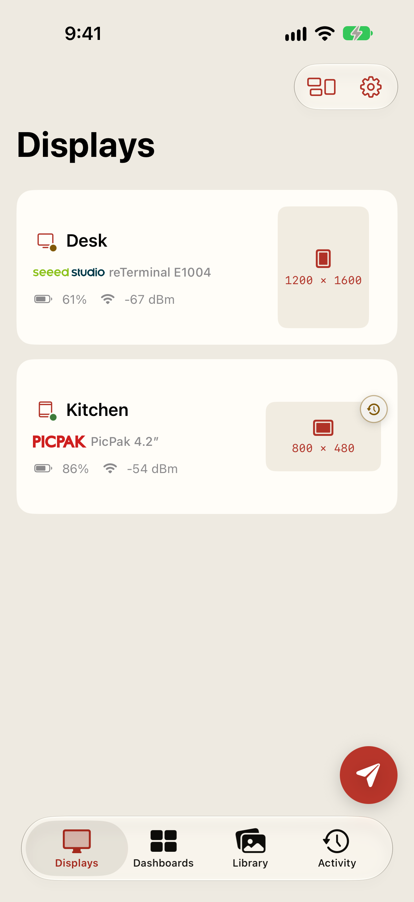</a></td>
    <td align="center"><a href="docs/images/readme/dashboards-floating-send.png">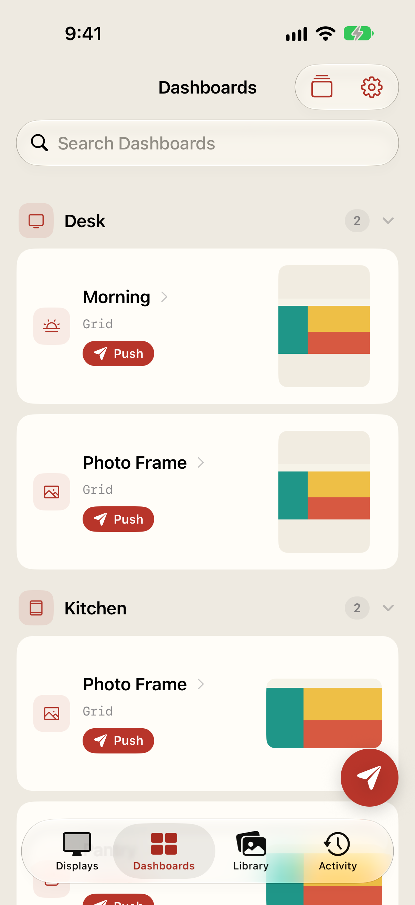</a></td>
    <td align="center"><a href="docs/images/readme/dashboard-settings-actions.png">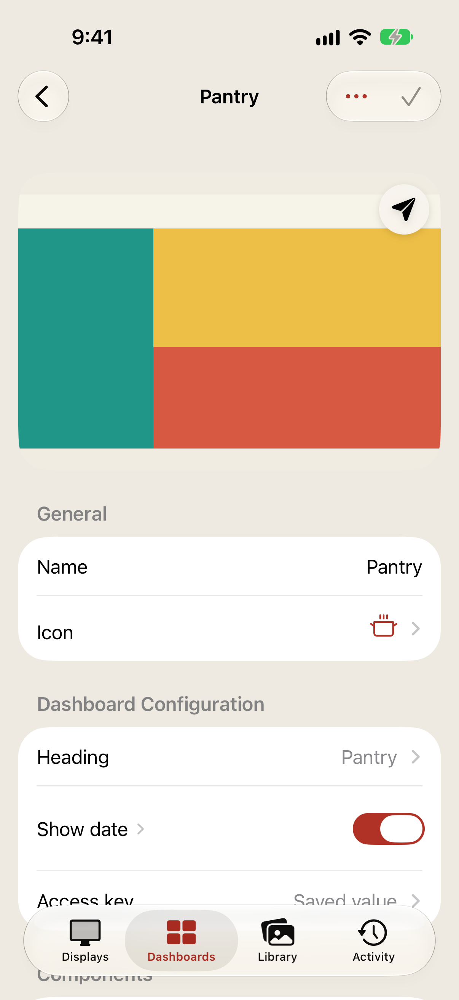</a></td>
    <td align="center"><a href="docs/images/readme/lineup-editor-actions.png">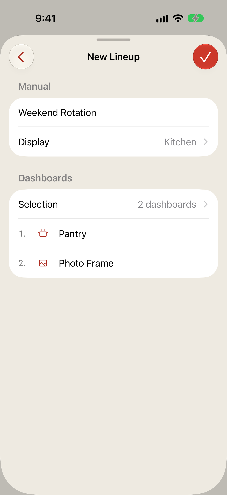</a></td>
  </tr>
  <tr>
    <td align="center"><sub><strong>Displays</strong><br>Status and current content</sub></td>
    <td align="center"><sub><strong>Dashboards</strong><br>Browse, preview, and push</sub></td>
    <td align="center"><sub><strong>Native settings</strong><br>Edit content and appearance</sub></td>
    <td align="center"><sub><strong>Lineups</strong><br>Choose targets and playback</sub></td>
  </tr>
  <tr>
    <td align="center"><a href="docs/images/readme/gallery-folder-actions.png">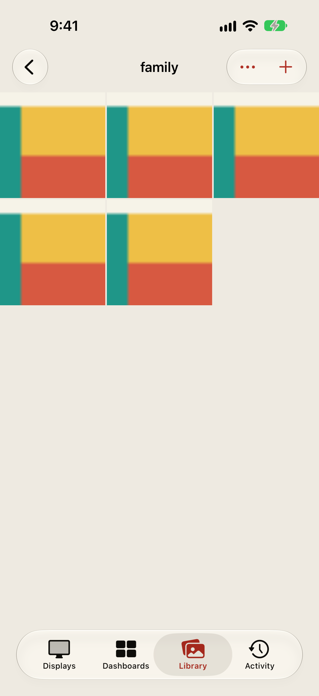</a></td>
    <td align="center"><a href="docs/images/readme/send-photo-compact-displays.png">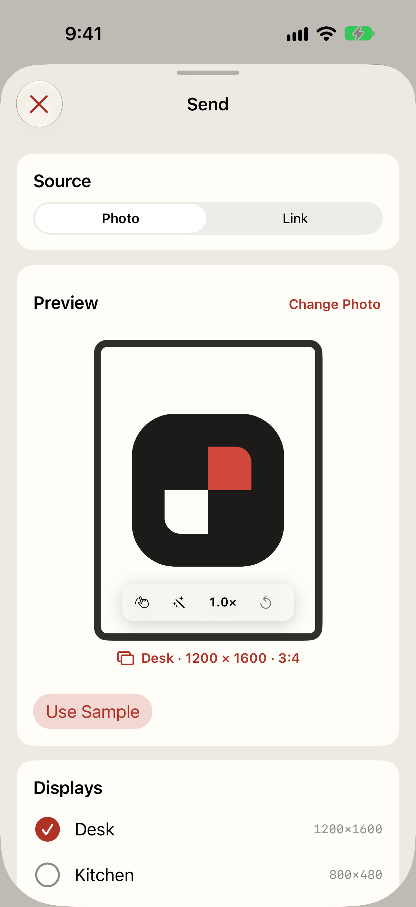</a></td>
    <td align="center"><a href="docs/images/readme/activity-floating-send.png">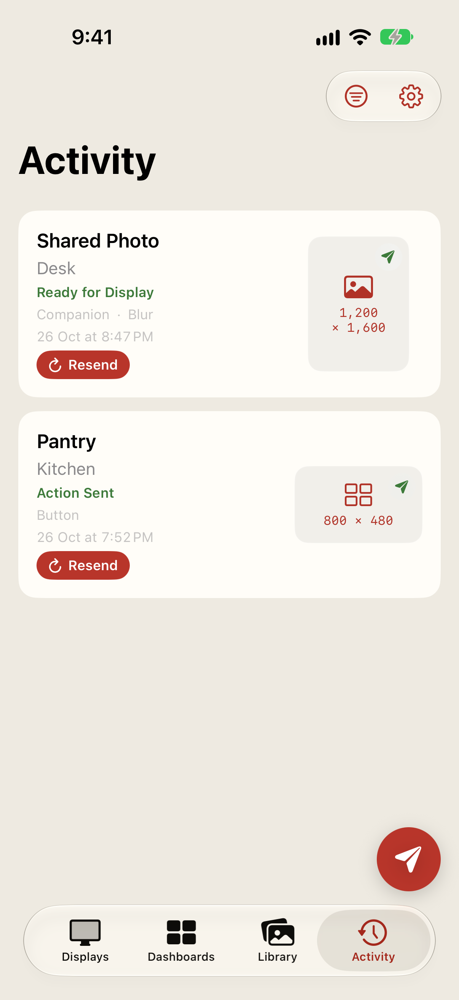</a></td>
    <td align="center"><a href="docs/images/readme/bluetooth-maintenance.png">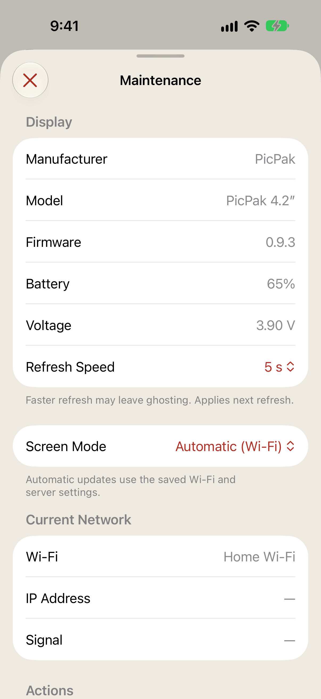</a></td>
  </tr>
  <tr>
    <td align="center"><sub><strong>Library</strong><br>Browse and send saved photos</sub></td>
    <td align="center"><sub><strong>Photo framing</strong><br>Compose for each display</sub></td>
    <td align="center"><sub><strong>Activity</strong><br>Follow sends and retry</sub></td>
    <td align="center"><sub><strong>Bluetooth</strong><br>Maintain nearby displays</sub></td>
  </tr>
</table>

<details>
<summary>More native editing screens</summary>

<table>
  <tr>
    <td align="center"><a href="docs/images/readme/dashboard-components.png">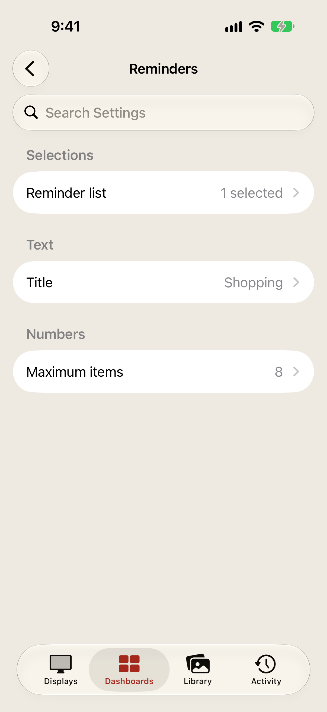</a></td>
    <td align="center"><a href="docs/images/readme/lineup-selection-actions.png">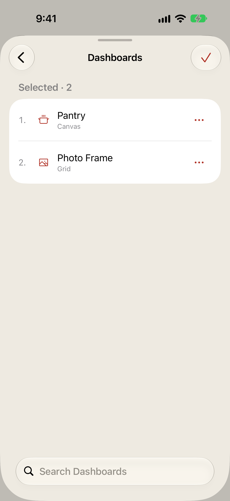</a></td>
    <td align="center"><a href="docs/images/readme/offline-album.png">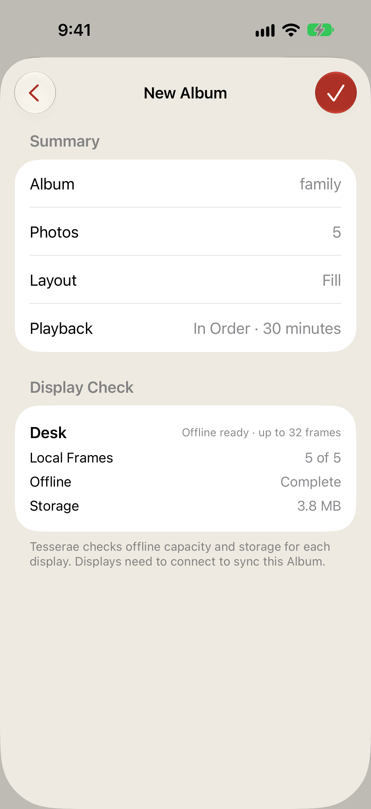</a></td>
    <td align="center"><a href="docs/images/readme/gallery-upload-details.png">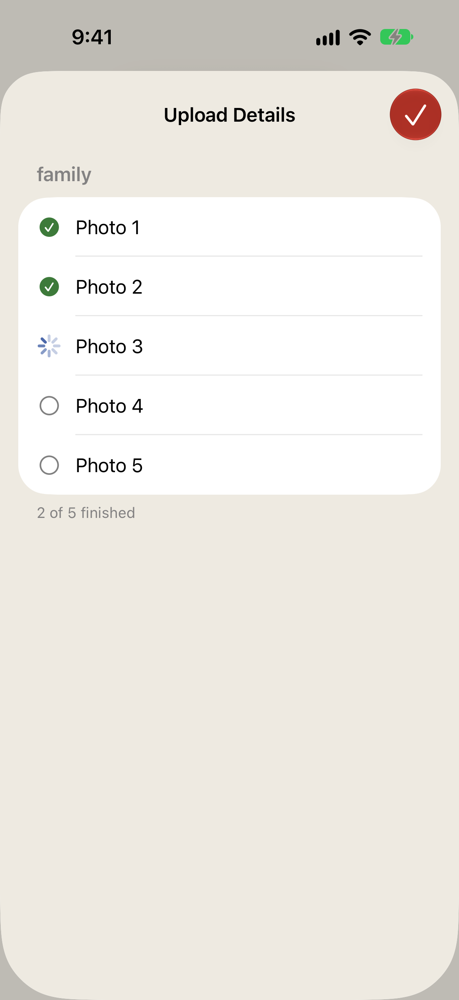</a></td>
  </tr>
  <tr>
    <td align="center"><sub><strong>Widget settings</strong><br>Edit individual controls</sub></td>
    <td align="center"><sub><strong>Lineup selection</strong><br>Choose and order content</sub></td>
    <td align="center"><sub><strong>Offline Albums</strong><br>Review display readiness</sub></td>
    <td align="center"><sub><strong>Uploads</strong><br>Follow individual photos</sub></td>
  </tr>
  <tr>
    <td colspan="2" align="center"><a href="docs/images/readme/dashboard-choices.png">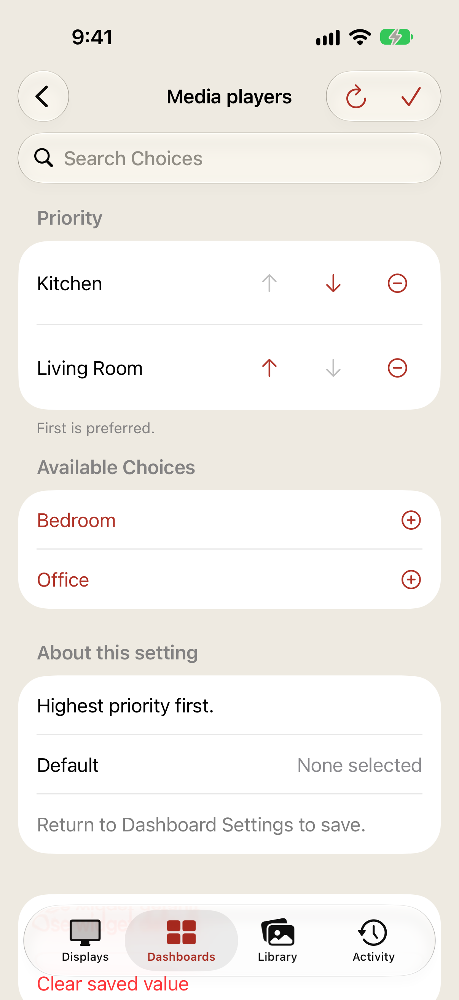</a></td>
    <td colspan="2" align="center"><a href="docs/images/readme/lineup-duration.png">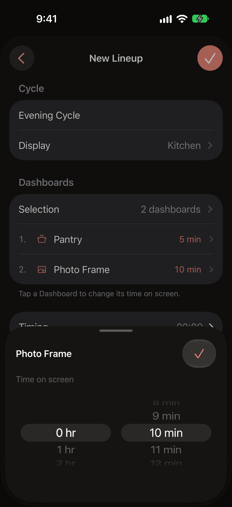</a></td>
  </tr>
  <tr>
    <td colspan="2" align="center"><sub><strong>Choice settings</strong><br>Select and prioritize values</sub></td>
    <td colspan="2" align="center"><sub><strong>Duration picker</strong><br>Set time on screen</sub></td>
  </tr>
</table>

</details>

Screenshots show the current development build on an iPhone simulator, using
demo content and simulated Bluetooth devices. Available
controls depend on your server and firmware; the TestFlight build may differ.

## What you can do

- **Displays:** check freshness, battery and Wi-Fi information, and preview
  current or pending content. Confirmed Bluetooth mode, battery readings and
  received-photo previews remain available locally across app restarts.
- **Dashboards:** browse and push saved content. On compatible servers, edit
  names, icons, display bindings, appearance, declared inputs and individual
  widget settings. Saves preserve other content and keep Push as a separate action.
- **Lineups:** create and edit Daily, Keep Fresh, Cycle and Manual playback on
  servers with Lineup authoring support, or inspect and control existing Lineups.
- **Library:** browse Gallery folders in square or original-ratio photo grids,
  adjust the grid density, upload photos and send a saved image. Supported
  displays can also use server-managed Offline Albums.
- **Send and Share:** send photos, image URLs and webpage snapshots; frame images
  for each display; share from other iOS apps; or run common actions in Shortcuts.
- **Personal Data:** opt in to selected Apple Reminders lists or Apple Health
  summaries, with independent permissions and server retention settings.

Dashboard creation, Canvas layout and code editing, plugin installation and
server administration remain in Tesserae's web interface.

### Photo framing

Use **Fill** and Auto Frame to compose around detected faces and subjects, then
adjust by dragging or pinching. Each preview aspect ratio keeps its own framing;
manual edits stay in place until you run Auto Frame again. Use Fit or Blur when
you want the whole image visible.

Analysis runs locally with Apple Vision on iOS 18 or later and does not require
Apple Intelligence. Framing works in Send and the Share Sheet when the server
advertises support. Queued Share sends keep their chosen composition and targets
for retries.

### Bluetooth and offline access

Cached screens appear while Companion reconnects. **Other Servers** and
**Bluetooth Maintenance** remain available when your server cannot be reached.
On supported firmware, nearby Bluetooth setup, diagnostics, restart and Wi-Fi
repair work without a server connection. Wi-Fi repair retains the display's
saved server settings. New device registration still needs a reachable server.

Supported Tesserae firmware also offers **Change Server**; PicPak maintenance
offers Wi-Fi repair. PicPak requires its assigned hardware code **20**—older
firmware using code 11 must be updated.

For automatic association with a differently named server device, Companion
submits a full MAC already obtained from authenticated Bluetooth and receives
only a matching device ID. It does not read MACs from the server's device list.
Device Details does not expose a manual Bluetooth linking control. Saved
observations are saved on this phone or tablet first, then retried in the foreground
when the server advertises `device_mode_observations`. The server retains the latest
confirmed mode and observation time as advisory metadata; it does not alter push
rules. Bluetooth keys and photos are not part of this report. A received photo does
not confirm a physical e-paper refresh.

PicPak Bluetooth photo sending uses its established protocol. The negotiated
photo protocol for E1004, E1001, E1003 and Sticky remains experimental and
requires compatible opt-in firmware and hardware acceptance. See the
[Bluetooth photo handoff](docs/plans/2026-10-21-ble-photo-v2-implementation.md) and
[PicPak throughput guide](docs/ble-photo-throughput-testing.md).

## Get started

1. Install [TestFlight](https://apps.apple.com/app/testflight/id899247664) and
   [join the beta](https://testflight.apple.com/join/gjQar3TK).
2. Explore **Demo Mode**, or discover your Tesserae server on the local network.
   You can also enter its address manually.
3. Pair using the Companion pairing code shown by Tesserae.
4. Grant optional editing or personal-data permissions only for the features
   you want to use.

Requires **iOS / iPadOS 18 or later** and a Tesserae server exposing the scoped
`/api/app/v1` Companion API. The app connects directly to your server; there is
no separate Companion cloud account. English and Simplified Chinese are included.

### Server and firmware support

Features are enabled by the server's advertised capabilities rather than by
assuming every Tesserae installation offers the same API.

| Feature | What it needs |
| --- | --- |
| Dashboard settings and widget editing | `dashboard_settings`, plus `dashboard_component_settings` for individual fields; an explicit optional `dashboards:write` grant to save |
| Lineup editing | `lineup_authoring` and the corresponding edit permission |
| Gallery and Offline Albums | The corresponding Gallery/Album capabilities and supported device firmware |
| Reminders and Health | The matching personal-data capability, iOS permission and an explicit choice to sync |
| Bluetooth setup, maintenance and photos | Firmware implementing the relevant Bluetooth protocol; available actions come from its reported capabilities |

The server additions for native Dashboard editing ([Tesserae #382](https://github.com/dmellok/tesserae/pull/382))
and known-MAC association ([#381](https://github.com/dmellok/tesserae/pull/381)) are
under review as of **24 October 2026**. Their presence in this app's demo does
not establish availability in a released server. See
[COMPATIBILITY.md](COMPATIBILITY.md) for capability gates and validation records.

## Your server, your data

Reminders and Health bridges are opt-in. Companion uploads the limited snapshots
needed by the selected widgets; it does not upload a complete Reminders or
Health database. In **Settings → Personal Data → Reminders / Health → Keep Synced
Data**, choose 1, 2 (default), 7, 30 or 90 days, or **Never**, then sync to apply.
Longer retention and Never require the server's `personal_data_retention` capability.

Retention belongs to this phone's source on the selected server. A stale label
after 24 hours does not itself hide or delete the snapshot before its chosen
deadline. See [PRIVACY.md](PRIVACY.md) for permissions, storage and data flow.

## Development

The app uses Swift 6 and SwiftUI. Use Xcode 16.4 or later; iPhone Duo development
requires Xcode 27.1 and its runtime. The deployment minimum remains iOS 18.
Ordinary iPhones use portrait; iPad and Duo layouts adapt to the available window.

| Location | Contents |
| --- | --- |
| `App/` | Native app, resources, unit tests and UI tests |
| `Packages/TesseraeKit/` | Shared models, HTTP transport, credentials and package tests |
| `ShareExtension/`, `SharedUI/` | Share composer and shared photo-framing UI |
| `Contracts/` | OpenAPI contract, fixtures, checks and local fixture server |
| `project.yml` | [XcodeGen](https://github.com/yonaskolb/XcodeGen) project source |

```sh
xcodegen generate
open TesseraeCompanion.xcodeproj
```

Run the package and contract checks:

```sh
swift test --package-path Packages/TesseraeKit
python3 -m venv .venv
.venv/bin/pip install -r Contracts/requirements.txt
.venv/bin/python -m pytest Contracts
```

For local development, `python3 Contracts/fixture_server.py --port 8765` serves
a stateful fixture at `http://127.0.0.1:8765` with any six-digit pairing code.
It is development infrastructure, not a Tesserae server. See
[CONTRIBUTING.md](CONTRIBUTING.md) for simulator checks and signing setup.

## Documentation

| Document | Purpose |
| --- | --- |
| [DESIGN.md](DESIGN.md) | Product, UX and architecture |
| [API_CONTRACT.md](API_CONTRACT.md) / [OpenAPI](Contracts/app-v1.openapi.yaml) | Server contract and ownership boundaries |
| [COMPATIBILITY.md](COMPATIBILITY.md) | Capability gates and validation evidence |
| [PRIVACY.md](PRIVACY.md) | Permissions, storage and retention |
| [TESTFLIGHT_CHECKLIST.md](TESTFLIGHT_CHECKLIST.md) / [TESTFLIGHT_NOTES.md](TESTFLIGHT_NOTES.md) | Release checks and beta guidance |
| [CHANGELOG.md](CHANGELOG.md) | User-visible changes |
| [CONTRIBUTING.md](CONTRIBUTING.md) | Development and contribution workflow |
| [SECURITY.md](SECURITY.md) | Security reporting |
| [ATTRIBUTION.md](ATTRIBUTION.md) | Tesserae name, mark and upstream boundaries |

## Licence and project boundary

Tesserae Companion is maintained separately from the Tesserae server because it
has its own Xcode, signing, App Store and release lifecycle. Tesserae's maintainer
has designated it as the official iOS app and permitted use of the name and mark
within the boundaries in [ATTRIBUTION.md](ATTRIBUTION.md).

The app's original code and documentation use [Apache License 2.0](LICENSE).
Tesserae is a separate project under AGPL-3.0-or-later; the client licence does
not change the server's licence or grant additional rights to its name or marks.
